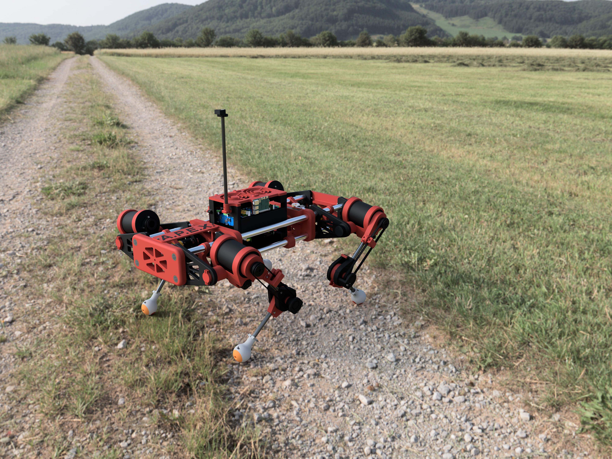

 **⚠️ This is an ongoing project. The code, CAD, and documentation are all actively being developed and are not final.**
 
---
 
# A.P.E.X. — **A**utonomous **P**recision **Ex**ploration
 
A fully custom-built quadruped robot dog designed and coded from scratch.

APEX is designed to walk across varied outdoor terrain using real-time inverse kinematics, stay balanced using an IMU, navigate to GPS waypoints autonomously, and stream live camera footage back to any device over WiFi. Onboard ML-based obstacle avoidance is built and awaiting tuning on the hardware, for fully autonomous terrain exploration.
 



 
---

## Features

- **Inverse Kinematics** — custom 3-link IK/FK engine computing joint angles for all four legs in real time
- **Body-Twist Steering** — the body yaws in place or arcs while walking, instead of tank-style steering
- **IMU Stabilization** — per-leg height correction keeps the body level on uneven ground
- **GPS Navigation** — follows waypoints entered live from the dashboard, then holds position at the end
- **ML Obstacle Avoidance** — a pretrained depth model turns the webcam feed into steering around obstacles
- **Live Video Streaming** — webcam feed to any device on the same network
- **Mission Control Dashboard** — web UI for homing, standing, walking, steering and navigation; works with no internet
- **Fault-Tolerant Sensors** — every sensor runs on its own thread, so a dead one degrades safely instead of freezing the robot
- **ROS 2 Integration** — dashboard and controller talk over ROS 2 topics
- **Per-Motor Current Sensing** — every motor driver's current is read and shown live on the dashboard; a mid-swing spike is treated as an early foot touchdown and triggers recovery

For how all of this works, see **[TECHNICAL.md](TECHNICAL.md)**.

---
 
## BOM
 
For the full, up-to-date bill of materials, see the [APEX BOM on Google Sheets](https://docs.google.com/spreadsheets/d/1m-T2-i6hj74-5jb7eDYWLMdHvXfgs2ABYw7gbwLl6ZI/edit?usp=sharing).

---
 
## Getting Started
 
> Full setup instructions are a work in progress. The notes below are enough to get running.
 
### Pi 5 Requirements
 
```bash
pip install -r Code/Pi5/requirements.txt
```

ROS 2 (Humble or later) is a separate apt install, needed only for `pi5_main.py`. To test without ROS, use `single_leg_test.py`.

- **Optional pieces:** obstacle avoidance (`onnxruntime` + the depth model) and the status OLED (`luma.oled`). If either is missing, everything else still runs.
- **Missing hardware is OK:** a dead IMU, GPS, compass, camera, power monitor or speaker won't stop the boot. It shows as FAIL in the boot log and on the OLED, and the dashboard shows an amber "running degraded" banner.
- **Private settings:** copy `Code/Pi5/.env.example` to `Code/Pi5/.env` and fill it in (currently the Bluetooth speaker's MAC). `.env` is gitignored.
- **Wiring and `/boot/firmware/config.txt`:** every I2C bus, UART and header pin is in [HARDWARE.md](HARDWARE.md).
 
### Running the single-leg test
 
```bash
cd Code/Pi5
python3 single_leg_test.py
```
 
Then open `http://<pi-ip>:5000` in a browser for the control panel and live camera feed.
 
### Running full production
 
```bash
cd Code/Pi5
source /opt/ros/humble/setup.bash
python3 pi5_main.py
```
 
### Pico Firmware
 
Flash each Pico with MicroPython, then copy the contents of `Code/Pico/` to the Pico filesystem. The main loop starts automatically on boot. **The legs do not move on their own** -- each Pico just holds its power-on position under light PID until it's homed. From the web dashboard: home each leg individually, then **Stand**, then **Go**. A **Stop** control cuts motor power without losing homing.
 
### ⚠ Before powering the motors
 
- **Re-flash all four Picos.** Seven firmware fixes live on the Pico side; a Pi running current code against old firmware still cannot stand, and still will not walk. See the banner in `ENGINEERING_NOTES.md`.
- **Copy every file in `Code/Pico/`** to each board, including `mcp3208.py`, `current_sense.py` and `contact_detect.py`.
- **Calibrate `TOUCHDOWN_AMPS` in `pico_main.py`.** The touchdown abort ships with uncalibrated 3.0 A placeholders. See `ENGINEERING_NOTES.md` → *Ground contact — current sensing replaced the FSR*.
- **Set `LEG_ID`** on each board — all four currently ship as `0`.
- **Check the IMU roll/pitch signs on a stand.** Levelling assumes right-side-down is positive roll and nose-up is positive pitch. If either axis is bolted in backwards the correction is positive feedback and will drive the robot over. Steps are in `ENGINEERING_NOTES.md` → *Before you walk it*.
 
---
 
## Project Status
 
| Component | Status |
|---|---|
| IK / FK engine | Complete |
| Gait generation | Complete |
| Pico PID motor control | Complete |
| Pi-Pico serial protocol | Complete — frames stage on the Pico, re-sends rate-limited to 10 Hz |
| IMU stabilization | Complete — **verify the roll/pitch signs on a stand first** |
| GPS navigation | Complete |
| Camera streaming | Complete |
| Recovery path | Complete |
| Homing / Stand / Go / Stop dashboard workflow | Complete |
| ML obstacle avoidance | Built, needs hardware tuning |
| Motor stall protection (software) | Complete — error *and* encoder must both stall; needs a bench check |
| Per-motor current sensing (BTS7960 `IS`, MCP3208) | Built, not yet run on hardware |
| Foot-contact abort (current-based, replaces FSR) | Built — thresholds need bench calibration |
| Motor Currents dashboard panel | Complete |
| Mechanical build | In progress |
| Custom PCB | In progress |
| CAD files | In progress |
 
---
 
## Repo Structure
 
```
APEX/
├── Code/
│   ├── Pi5/             # Raspberry Pi 5 code (ROS 2 node, dashboard, sensors, vision)
│   └── Pico/            # RP2040 MicroPython firmware (one copy runs on every leg)
├── CAD/                 # Fusion 360 leg and body models, PCB V1 design and Gerber files
├── Photos/              # Build photos
├── README.md            # This file
├── TECHNICAL.md         # How it works: architecture, protocol, gait, control loop, vision, dashboard
├── HARDWARE.md          # Pi 5 buses and pins, config.txt, OLED, Pico boards, speaker
└── ENGINEERING_NOTES.md # Open issues, bench checklists, resolved defects, planned work
```
 
---
 
## Contact
 
Questions or inquiries: [apex.quadrupedalrobot@gmail.com](mailto:apex.quadrupedalrobot@gmail.com)

**Want your own APEX?** Whether it's for educational, personal, commercial, or any other use, email [apex.quadrupedalrobot@gmail.com](mailto:apex.quadrupedalrobot@gmail.com) to purchase one.

---

## License
 
MIT
 
---
